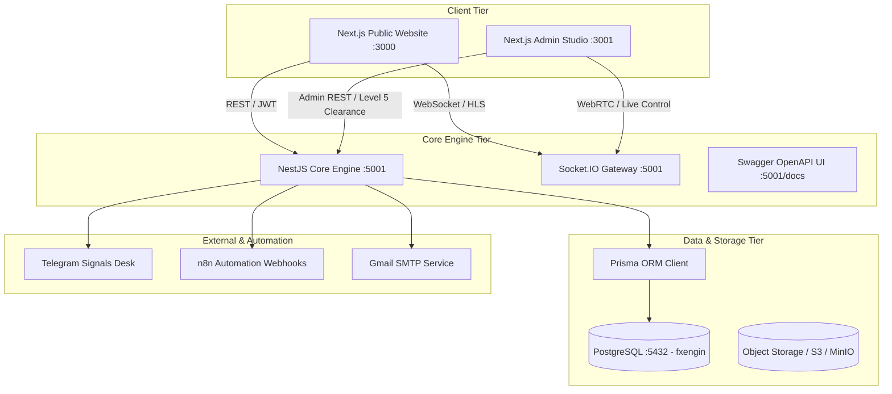
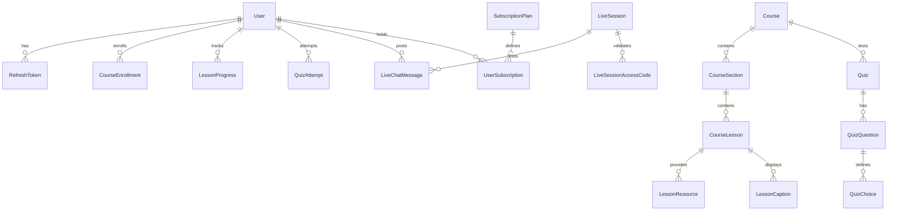

# FXEngin Platform — Comprehensive Project Test Map
**Document Version:** 1.0.0  
**Classification:** Enterprise QA Architectural Dossier  
**Author:** Senior QA Engineer + Test Automation Engineer + Quality Architect  
**Date:** September 2026  

---

## 1. Executive Architecture Overview

FXEngin is an institutional-grade Forex educational platform, real-time trading signals hub, algorithmic trading analysis center, and sovereign live-streaming academy.

---

## 2. Platform Services & Runtime Configuration

| Service Name | Technology Stack | Configured Port | Main Responsibility |
|---|---|---|---|
| **fx-backenf** | NestJS 10, TypeScript, Prisma, Passport, Socket.io | `5001` (Dev) / `5000` (Prod) | REST Core API, Auth/RBAC, Live Gateway, LMS, Payment/Order processing, Webhooks |
| **fx-engin** | Next.js 14 (App Router), React, Tailwind, Framer Motion | `3000` | Trader public portal, Courses catalog, Live player, Market tickers, Checkout |
| **fxengin-admin** | Next.js 14 (App Router), React, Lucide, Chart.js | `3001` | Sovereign Control Studio, User RBAC, Broadcast control, Course editor, Ads management |
| **Database** | PostgreSQL 16 | `5432` (fxengin) | Relational persistence with 30 schema tables |
| **Media/Stream** | WebRTC / HLS / RTMP | Variable / SRS | Anti-leak live stream ingestion & playback |

---

## 3. Complete Pages & Navigation Map

### 3.1 Public Trader Portal (`fx-engin` — Port 3000)

| Route Path | Type | Access Level | Key Features / Components |
|---|---|---|---|
| `/` | SSR / Client | Public | Hero, Market ticker, Featured courses, Live preview, Testimonials, Newsletter |
| `/login` | Client | Public / Guest | Dual login (Password + OTP Direct), Google OAuth trigger, Validation |
| `/register` | Client | Public / Guest | Form validation, password rules, experience level, OTP trigger |
| `/forgot-password`| Client | Public / Guest | 6-digit OTP email dispatch, secure password reset |
| `/courses` | SSR / Client | Public | Category filtering, search, difficulty pills, price badges |
| `/courses/[id]` | SSR / Client | Public / Authenticated | Curriculum syllabus, preview video, enrollment trigger, pricing |
| `/courses/[id]/learn`| Client | Authenticated (Enrolled) | Anti-leak video stream, lesson progress, quiz attempts, resources |
| `/markets` | Client | Public | Live quotes, currency pairs, technical widgets, spreads |
| `/analyses` | SSR / Client | Public | Daily technical market analysis, sentiment, chart attachments |
| `/analyses/[id]` | SSR / Client | Public | Single analysis breakdown, analyst credentials, market view |
| `/blog` | SSR / Client | Public | Educational articles, category filter, read time, search |
| `/blog/[id]` | SSR / Client | Public | Article body, social share, related posts |
| `/brokers` | SSR / Client | Public | Top rated brokers, regulation badges, spread comparisons, referral links |
| `/live` | Client | Public / Authenticated | Live stream index, upcoming sessions calendar, countdown timer |
| `/live/[idOrSlug]` | Client | Public / Tier-gated | HLS video player, floating instructor tab, real-time chat room, access code gate |
| `/checkout` | Client | Authenticated | Order summary, discount coupon engine, Telegram checkout dispatch |
| `/profile` | Client | Authenticated (JWT) | Personal info, enrolled courses, active subscriptions, security settings |
| `/contact` | Client | Public | Contact support form, email dispatch, institutional credentials |
| `/about` | SSR | Public | Company mission, executive team, trading philosophy |
| `/partners` | SSR | Public | Affiliate & brokerage partnership program |
| `/privacy`, `/terms`, `/disclaimer` | SSR | Public | Regulatory & legal disclosures, risk warning |

### 3.2 Sovereign Admin Studio (`fxengin-admin` — Port 3001)

| Route Path | Type | Guard Clearance | Key Modules & Operations |
|---|---|---|---|
| `/login` | Client | Public / Unauth | Super Admin & Admin master sign-in, brute-force throttle |
| `/dashboard` | Client | `ADMIN` / `SUPER_ADMIN` | Executive KPI cards, real-time telemetry, recent signups, system health |
| `/dashboard/users` | Client | `ADMIN` / `SUPER_ADMIN` | User listing, search/filter, role modification, ban/activate, delete (Super Admin) |
| `/dashboard/courses`| Client | `ADMIN` | Course CRUD, Section/Lesson builder, video asset binder, Quiz designer |
| `/dashboard/live` | Client | `ADMIN` | Studio broadcast controller, WebRTC camera/screen share, RTMP credentials |
| `/dashboard/articles`| Client | `ADMIN` | Rich text article editor, category tagging, publish toggle |
| `/dashboard/analysis`| Client | `ADMIN` | Technical analysis dispatcher, sentiment tags, chart image upload |
| `/dashboard/brokers` | Client | `ADMIN` | Broker profile CRUD, rating scores, affiliate URLs, logo uploader |
| `/dashboard/subscriptions` | Client | `ADMIN` | Pricing plans CRUD, coupon code manager, active subscriber ledger |
| `/dashboard/ads` | Client | `ADMIN` | Google AdSense tag injector, banner placement rules, ads.txt manager |
| `/dashboard/pages` | Client | `ADMIN` | Dynamic CMS page builder (About, Terms, Custom landing pages) |
| `/dashboard/settings`| Client | `SUPER_ADMIN` | Platform global branding, maintenance mode toggle, SMTP/Telegram keys |

---

## 4. API Endpoints Map (NestJS Core :5001)

### 4.1 Authentication & Profile (`/auth`)
- `POST /auth/register` — Trader account registration
- `POST /auth/login` — Standard password login
- `POST /auth/login-otp` — Direct login with 6-digit OTP
- `POST /auth/send-otp` — Generate & email verification OTP
- `POST /auth/verify-otp` — Validate active OTP code
- `POST /auth/forgot-password` — Password recovery dispatch
- `POST /auth/reset-password` — OTP-backed password reset
- `POST /auth/refresh` — Refresh token rotation
- `POST /auth/logout` — Revoke active session token
- `POST /auth/social` — Google OAuth credential exchange
- `GET /auth/me` — Authenticated identity retrieval
- `PATCH /auth/profile` — Update user profile data
- `PATCH /auth/change-password` — Secure password update

### 4.2 Administrative Auth & Clearance (`/admin/auth`)
- `POST /admin/auth/login` — Isolated admin portal login with rate-limiting
- `POST /admin/auth/register` — Provision new admin (Super Admin only)
- `GET /admin/auth/me` — Active admin user token inspection
- `GET /admin/auth/super-admin` — Level 5 clearance dossier & cryptographic keys

### 4.3 Institutional User Management (`/admin/users`)
- `GET /admin/users` — Paginated user directory with search/filters
- `GET /admin/users/metrics/summary` — User analytics & growth telemetry
- `GET /admin/users/:id` — Granular user dossier (courses, sessions, orders)
- `POST /admin/users` — Direct administrative user creation
- `PATCH /admin/users/:id` — Update profile/experience details
- `PATCH /admin/users/:id/status` — Ban/activate toggle
- `PATCH /admin/users/:id/role` — Role promotion/demotion (Super Admin only)
- `POST /admin/users/:id/reset-password` — Administrative password override
- `DELETE /admin/users/:id` — Hard deletion (Super Admin only)
- `POST /admin/users/bulk-delete` — Batch user purging (Super Admin only)

### 4.4 Academy & LMS (`/courses`, `/admin/courses`)
- `GET /courses` — Public course catalog (published only)
- `GET /courses/:slug` — Course syllabus and details
- `POST /courses/:id/enroll` — User enrollment action
- `GET /courses/my/enrolled` — Authenticated user's active courses
- `GET /courses/lessons/:lessonId/stream` — Chunked anti-leak video streaming
- `POST /courses/lessons/:lessonId/progress` — Update completion progress
- `GET /courses/quizzes/:quizId` — Fetch quiz questions
- `POST /courses/quizzes/:quizId/submit` — Automated quiz grading engine
- `POST /admin/courses` — Create new course
- `PATCH /admin/courses/:id` — Update course metadata/pricing
- `DELETE /admin/courses/:id` — Remove course & cascade lessons

### 4.5 Live Broadcasting & WebRTC (`/live`, `/admin/live`)
- `GET /live` — Directory of live & scheduled broadcasts
- `GET /live/:idOrSlug` — Stream metadata and access gate check
- `POST /live/:id/verify-access` — Access code / VIP entitlement verification
- `GET /live/:id/ticket` — Generate ephemeral playback ticket
- `POST /admin/live` — Schedule new live broadcast
- `PATCH /admin/live/:id` — Update session parameters / stream keys
- `POST /admin/live/:id/start` — Trigger live state & notify subscribers
- `POST /admin/live/:id/end` — Terminate live session & archive
- `POST /live/webhook/on_publish` — SRS / RTMP ingestion authentication callback
- `POST /live/webhook/on_unpublish` — Stream disconnect handler

### 4.6 Market Intelligence & Signals (`/analyst`, `/signals`, `/market`)
- `GET /market/quotes` — Live FX tickers (EURUSD, XAUUSD, etc.)
- `GET /analyst/feed` — Curated market analysis articles
- `POST /admin/analyst` — Dispatch technical analysis with chart attachments
- `GET /signals` — Active trading signals (VIP gated)
- `POST /admin/signals` — Broadcast new trading signal

### 4.7 CMS, Ads & System Settings (`/articles`, `/brokers`, `/cms`, `/settings`, `/ads`)
- `GET /articles`, `POST /admin/articles`, `PATCH /admin/articles/:id`
- `GET /brokers`, `POST /admin/brokers`, `PATCH /admin/brokers/:id`
- `GET /pages/:slug`, `POST /admin/pages`, `PATCH /admin/pages/:id`
- `GET /settings/public`, `PATCH /admin/settings`
- `GET /ads/active`, `GET /ads/ads-txt`, `PATCH /admin/ads/settings`

---

## 5. Database Entities & Relationship Matrix

### 30 Relational Models in `fxengin`:
1. `User` (email unique, passwordHash, role, isActive, experienceLevel)
2. `RefreshToken` (tokenHash unique, user relation, cascade delete)
3. `Course` (slug unique, accessTier, price, discountPrice, isPublished)
4. `CourseSection` (courseId relation, sortOrder)
5. `CourseLesson` (sectionId relation, videoUrl, isFreePreview, duration)
6. `LessonCaption` (lessonId, vttUrl, language)
7. `LessonResource` (lessonId, fileUrl, title)
8. `Quiz` (courseId, passScore, maxAttempts)
9. `QuizQuestion` (quizId, questionText, points)
10. `QuizChoice` (questionId, choiceText, isCorrect)
11. `QuizAttempt` (userId, quizId, score, passed)
12. `CourseEnrollment` (userId, courseId, unique composite)
13. `LessonProgress` (userId, lessonId, isCompleted, secondsWatched)
14. `LiveSession` (streamKey, status: SCHEDULED/LIVE/ENDED, accessTier)
15. `LiveChatMessage` (sessionId, userId, message, isInstructor)
16. `LiveSessionAccessCode` (sessionId, code unique, maxUses)
17. `SubscriptionPlan` (name, slug, priceMonthly, priceYearly, features)
18. `UserSubscription` (userId, planId, status, expiresAt)
19. `Coupon` (code unique, discountPercentage, expiresAt, maxUses)
20. `OtpVerification` (email, otpCode, purpose, expiresAt, isUsed)
21. `Advertisement` (slot, imageUrl, redirectUrl, isActive)
22. `GoogleAdSenseConfig` (publisherId, clientScript, autoAdsEnabled)
23. `Signal` (pair, action, entryPrice, stopLoss, takeProfit, isVipOnly)
24. `ContactMessage` (fullName, email, subject, message, isRead)
25. `NewsletterSubscriber` (email unique, isActive, token)
26. `Testimonial` (authorName, rating, content, isApproved)
27. `SystemSetting` (key unique, value, group)
28. `Article` (slug unique, title, body, category, isPublished)
29. `Broker` (name, slug unique, rating, spread, leverage, logoUrl)
30. `CmsPage` (slug unique, title, contentHtml, isPublished)

---

## 6. Roles & Institutional Permissions Matrix

| Capability / Resource | GUEST / Public | USER (Free) | TRADER / VIP | ADMIN | SUPER_ADMIN |
|---|:---:|:---:|:---:|:---:|:---:|
| Browse Public Web & Tickers | ✅ | ✅ | ✅ | ✅ | ✅ |
| Access Free Courses & Lessons | ❌ | ✅ | ✅ | ✅ | ✅ |
| Access VIP Courses & Live Stream | ❌ | ❌ | ✅ | ✅ | ✅ |
| Post in Live Stream Chat | ❌ | ✅ | ✅ | ✅ (Instructor) | ✅ (Master) |
| Order / Checkout via Telegram | ❌ | ✅ | ✅ | ✅ | ✅ |
| Admin Studio Login (`:3001`) | ❌ | ❌ | ❌ | ✅ | ✅ |
| Create / Edit Courses & Articles | ❌ | ❌ | ❌ | ✅ | ✅ |
| Start / Terminate Live Broadcasts | ❌ | ❌ | ❌ | ✅ | ✅ |
| View User Directory & Analytics | ❌ | ❌ | ❌ | ✅ | ✅ |
| Ban / Activate User Accounts | ❌ | ❌ | ❌ | ✅ | ✅ |
| Modify User Roles (Promote to Admin)| ❌ | ❌ | ❌ | ❌ | ✅ |
| Hard Delete Users / Bulk Purge | ❌ | ❌ | ❌ | ❌ | ✅ |
| Access Super Admin Cryptographic Dossier| ❌ | ❌ | ❌ | ❌ | ✅ |
| Modify Global System Branding & Keys | ❌ | ❌ | ❌ | ❌ | ✅ |

---

## 7. Critical Business Workflows

1. **Trader Onboarding & Instant Verification:**
   `Register Form` -> `POST /auth/send-otp` -> `Verify OTP` -> `Auto-login with JWT` -> `Redirect to /courses`.
2. **Password Recovery Flow:**
   `Forgot Password` -> `Verify 6-digit OTP` -> `POST /auth/reset-password` -> `Encrypted Bcrypt sync`.
3. **Course Discovery & Enrollment:**
   `Browse Catalog` -> `Select Course` -> `Check Access Tier` -> `Auto-enroll if FREE` -> `Redirect to /checkout if PAID`.
4. **Checkout & Instant Telegram Fulfillment:**
   `Cart Item` -> `Apply Coupon` -> `Order Submission` -> `Dispatch to Telegram Desk (@FXenginsignals)` -> `Redirect with prefilled Telegram URL`.
5. **Interactive Live Broadcast Workflow:**
   `Admin Studio` -> `Schedule Session` -> `Get RTMP / WHIP Credentials` -> `Start Live Broadcast` -> `Users view HLS player with real-time SSE chat`.
6. **Administrative Governance Workflow:**
   `Super Admin Sign-in` -> `Review Telemetry KPIs` -> `Moderate Users / Elevate Roles` -> `Publish Market Signals`.

---

## 8. High-Risk Failure Points & Test Risks

1. **Port Bindings & Environment Conflicts:** Hardcoded `localhost:5000` URLs failing if port 5000 is occupied by an external service.
2. **Missing Token Checks / Hydration Mismatch:** Client-side `AuthContext` calling undefined imports or desyncing SSR state.
3. **Privilege Escalation Vulnerabilities:** Ensuring standard `ADMIN` cannot elevate users to `SUPER_ADMIN` or execute bulk deletion.
4. **Token Refresh Deadlocks:** Ensuring expired JWT tokens gracefully refresh without trapping the user in infinite redirects.
5. **RTL / LTR Bi-Directional Layout Breakages:** Ensuring Arabic typography, table columns, drawer navigation, and modal dialogues render correctly.
