# FXEngin Enterprise Platform — Quality & Test Strategy
**Document Version:** 1.0.0  
**Classification:** Quality Architecture Standard & Test Automation Strategy  
**Author:** Senior QA Engineer + Test Automation Engineer + Quality Architect  
**Date:** September 2026  

---

## 1. Quality Objectives & Standards

The quality standard for FXEngin requires zero production-blocking regressions, strict role-based access control, cryptographic session integrity, high availability of streaming services, seamless Arabic/English RTL/LTR switching, and resilience against network/database degradation.

### Priority Classification Matrix:
- **P0 (Critical / Production Blocker):** System unbootable, auth bypass, data corruption, crashes, unauthorized privilege escalation, non-working checkout.
- **P1 (High):** Major functional defects, broken CRUD workflows, unhandled 500 errors, broken pagination, failed language switches.
- **P2 (Medium):** UI misalignment, subtle responsive glitches on tablets, missing error toast feedback, non-critical validation inconsistencies.
- **P3 (Low):** Minor visual polish, tooltip delays, minor contrast nuances, non-critical translation omissions.

---

## 2. 20-Point Multi-Dimensional Test Strategy

### 1. Functional Testing (P0 / P1)
- Verify end-to-end functionality of all 30 database-backed entities.
- Validate course catalog filtering, search, pagination, difficulty toggling.
- Test checkout calculation: base price, coupon percentage deduction, free courses bypass.
- Test real-time live streaming state machine: `SCHEDULED` -> `LIVE` -> `ENDED`.

### 2. UI Testing (P1 / P2)
- Test all interactive components: modals, drawers, dropdowns, tabs, accordion syllabus, floating instructor player.
- Verify active states, loading skeletons, empty states, and toast notifications across all pages.
- Check z-index layering between fixed navbars, floating live player, and modal backdrops.

### 3. API Testing (P0 / P1)
- Automated API test suite covering all 33 controllers.
- Test HTTP methods (GET, POST, PATCH, DELETE).
- Verify correct status codes: `200 OK`, `201 Created`, `400 Bad Request`, `401 Unauthorized`, `403 Forbidden`, `404 Not Found`, `409 Conflict`, `422 Unprocessable Entity`, `429 Too Many Requests`.
- Validate response schemas, pagination envelopes (`{ success: true, data: [...], meta: { total, page, limit } }`), and error payloads.

### 4. Authentication Testing (P0)
- Trader registration with email, password hash verification (bcrypt 12 rounds), role defaults (`USER`).
- Standard password login vs Direct 6-digit OTP login.
- Brute-force throttling on `/auth/login` and `/admin/auth/login`.
- JWT access token generation, 1-hour expiration, and refresh token rotation with cryptographically hashed storage.
- Session revocation on logout and global session invalidation (`/auth/revoke-all`).

### 5. Authorization & RBAC Testing (P0)
- Verify `JwtAuthGuard`, `AdminGuard`, and `SuperAdminGuard`.
- Test access denial for regular `USER` trying to access `/admin/*` APIs.
- Test access denial for standard `ADMIN` attempting Super Admin operations:
  - Role promotion/demotion (`PATCH /admin/users/:id/role`).
  - User deletion (`DELETE /admin/users/:id`).
  - Accessing the cryptographic dossier (`GET /admin/auth/super-admin`).
  - Global system settings modification (`PATCH /admin/settings`).

### 6. Database Testing (P0 / P1)
- Verify Prisma schema constraints: unique constraints (`User.email`, `Course.slug`, `RefreshToken.tokenHash`, `Coupon.code`).
- Test foreign key cascades: deleting user cascades refresh tokens and progress records.
- Verify transaction integrity in checkout and enrollment processes.
- Ensure test isolation: no destruction of existing master accounts or live configurations.

### 7. Integration Testing (P0 / P1)
- Test end-to-end communication between `fx-engin` (Next.js), `fx-backenf` (NestJS), and PostgreSQL.
- Test Next.js proxy route handlers (`/api/[...path]`) forwarding headers and bearer tokens to NestJS.
- Verify Telegram notification dispatch integration.

### 8. End-to-End (E2E) Testing (P0)
- **Journey 1 (New Trader Journey):** Guest -> Landing Page -> Register -> Auto-login -> Browse Courses -> Free Course Enrollment -> Anti-leak Lesson Viewer.
- **Journey 2 (VIP Checkout Journey):** Authenticated User -> Select VIP Course -> Apply Discount Coupon -> Submit Order -> Telegram Direct Dispatch.
- **Journey 3 (Admin Operational Journey):** Admin Login -> Executive Dashboard -> Create Course -> Add Section & Lesson -> Publish Course -> Verify instant visibility in Public Web.
- **Journey 4 (Super Admin Security Governance):** Super Admin Login -> Users Directory -> Inspect User -> Ban / Unban User -> Modify Role -> Audit Dossier.

### 9. Validation Testing (P1)
- Client-side validation: instant feedback, email regex, minimum password length (8 chars), required fields.
- Server-side validation: NestJS `ValidationPipe` with `whitelist: true`, `forbidNonWhitelisted: true`.
- Boundary testing: empty strings, extremely long strings (5000+ chars), SQL injection patterns, script injection.

### 10. Error Handling & Graceful Degradation (P1)
- Test system behavior when backend service is unavailable or slow.
- Verify custom 404 and 500 error pages.
- Verify React error boundaries prevent white-screen crashes on network or data errors.
- Ensure sensitive stack traces and database credentials are never exposed in API error payloads.

### 11. Security Testing (P0)
- OWASP Top 10 defenses:
  - XSS injection in blog/article rich text and user names.
  - SQL / NoSQL Injection deterrence through Prisma parameterized queries.
  - IDOR (Insecure Direct Object Reference) testing on private lessons and user profile modifications.
  - Helmet security headers: `cross-origin-resource-policy`, `x-frame-options`, `x-content-type-options`.
  - Rate limiting & anti-brute force throttling on authentication endpoints.

### 12. Responsive Design Testing (P1 / P2)
- Form factors:
  - Mobile (375px - 414px: iPhone SE, iPhone 14 Pro, Pixel 7)
  - Tablet (768px - 820px: iPad Mini, iPad Air)
  - Desktop / Laptop (1280px, 1440px, 1920px)
- Inspect mobile drawer navigation, table horizontal scrolling (`overflow-x-auto`), card grids, live video responsive aspect ratio (16:9).

### 13. Browser Compatibility (P2)
- Chromium-based engines (Google Chrome, Brave, Edge).
- WebKit (Safari).
- Gecko (Firefox).
- Verify CSS grid, flexbox, Backdrop blur (`backdrop-filter`), and WebRTC/HLS video playback across engines.

### 14. Localization Testing (P1 / P2)
- Arabic (`ar`) default vs English (`en`).
- Test dynamic dictionary translation in `fx-engin/app/i18n/translations.js`.
- Detect missing translation keys, fallback mechanisms, and hardcoded texts.

### 15. RTL / LTR Bi-Directional Testing (P1)
- HTML document attributes: `dir="rtl"` and `lang="ar"` vs `dir="ltr"` and `lang="en"`.
- Directional icons and arrows: back/next paginators, chevron indicators, drawer slide-in directions.
- Form field label alignment, input text alignments, and table column order.

### 16. Performance Sanity Testing (P2)
- Time-to-First-Byte (TTFB) and API response latency (< 150ms target for cached endpoints).
- Asset optimization: SVG icons, Next.js image optimization (`next/image`).
- Identify duplicate or unnecessary API calls on page mounts.

### 17. Regression Testing (P0)
- Automated verification after every bug fix to guarantee zero collateral damage.
- Re-execution of core authentication, enrollment, and administrative access suites.

### 18. Accessibility Testing (a11y) (P2 / P3)
- Keyboard navigation (Tab order, Enter/Space activation, Esc modal dismissal).
- Color contrast ratios (WCAG AA compliance on dark/light themes).
- ARIA labels on icon buttons, form input accessibility (`id` / `htmlFor` association).

### 19. Edge Cases & Boundary Value Analysis (P1 / P2)
- Concurrent login from multiple sessions.
- Invalid token formats (`Bearer invalid.jwt.token`, malformed Base64).
- High volume pagination requests (`?limit=999999`).
- Expired discount coupons and zero-value checkout amounts.

### 20. Failure Recovery & Self-Healing Testing (P1)
- Database reconnection resilience after transient disconnection.
- Auto-reconnect behavior for Socket.IO live chat upon network drop.
- LocalStorage token desynchronization recovery (automatic logout on invalid token).

---

## 3. Test Execution Pipeline

```mermaid
flowchart LR
    Init[1. Environment Health Check] --> Boot[2. Unified Platform Launch]
    Boot --> Static[3. Linting & Static Code Audit]
    Static --> UnitAPI[4. Automated Unit & API Integration Tests]
    UnitAPI --> LiveUI[5. Headless Browser & Live UI Exploration]
    LiveUI --> Security[6. Defensive Security & RBAC Probing]
    Security --> Bugs[7. Bug Reproduction & Safe Remediation]
    Bugs --> Retest[8. Retest & Full Regression Suite]
    Retest --> Gate[9. Quality Gate Verification & Final Report]
```

